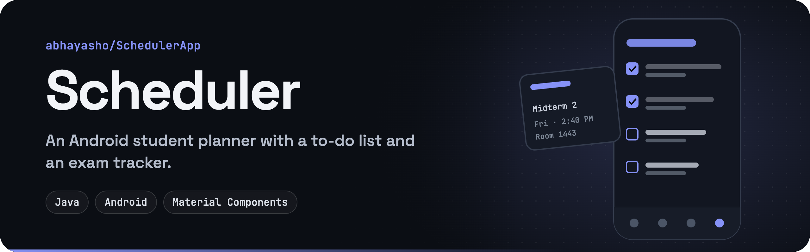

<p align="center">
  
</p>

<p align="center">
  
  
  
  
</p>

**Scheduler** is a lightweight Android planner for students. A bottom navigation bar switches between four tabs: a to-do list with deadlines, an exam tracker, and screens for your class schedule and assignments.

## Features

| Tab | What you can do |
| --- | --- |
| ✅ **To-Do** | Add a task with a deadline, check it off, edit it in a dialog, or delete it |
| 📝 **Exam** | Add an exam with its class, date, time and location to a running list |
| 📅 **Schedule** | Placeholder screen for the weekly class schedule *(coming soon)* |
| 📚 **Assignment** | Placeholder screen for assignment tracking *(coming soon)* |

## Built with

- **Java** with the Android SDK (compile and target SDK 34, minimum SDK 21)
- **AndroidX:** AppCompat, Fragments, ConstraintLayout, View Binding
- **Material Components:** `BottomNavigationView` and theming
- **Gradle** and Android Studio

## How it's organized

```
Scheduler/app/src/main/java/com/example/scheduler/
├── MainActivity.java        hosts the fragments, wires up the bottom navigation
├── TodoFragment.java        to-do list: add, complete, edit, delete
├── ExamFragment.java        exam list: class, date, time, location
├── ScheduleFragment.java    schedule tab (placeholder)
└── AssignmentFragment.java  assignment tab (placeholder)
```

Each tab is a `Fragment`. `MainActivity` swaps them into a `FrameLayout` when you pick a tab.

## Getting started

1. Clone the repo:
   ```bash
   git clone https://github.com/abhayasho/SchedulerApp.git
   ```
2. In Android Studio, choose **File → Open** and select the `Scheduler/` folder.
3. Let Gradle sync, then run the `app` configuration on an emulator or a device (Android 5.0+).

## Roadmap

- [ ] Save tasks and exams across app restarts (Room or SharedPreferences)
- [ ] Build out the Schedule tab as a weekly calendar view
- [ ] Build out the Assignment tab with due dates per class
- [ ] Date and time pickers instead of free-text fields
- [ ] Reminder notifications before deadlines and exams

## License

[MIT](LICENSE) © 2025 Abhay Ashok
